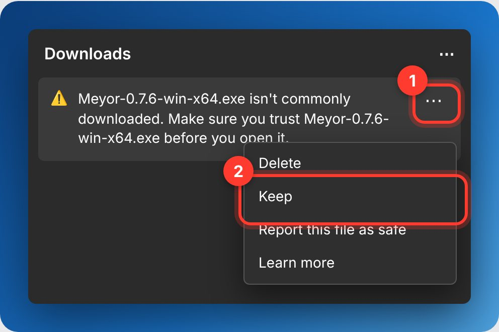
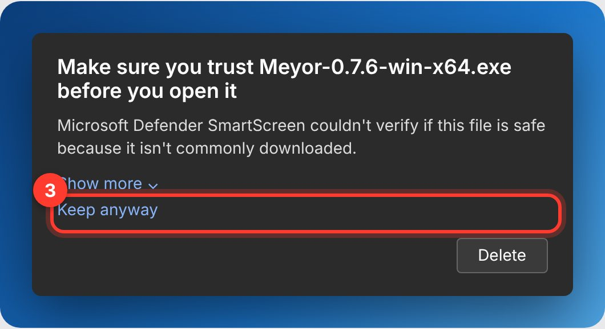
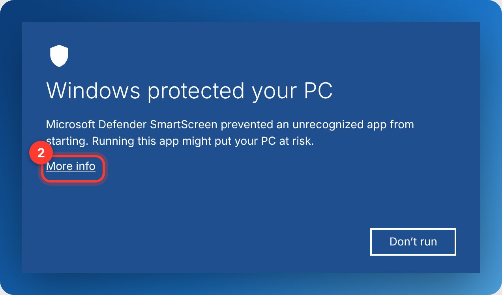
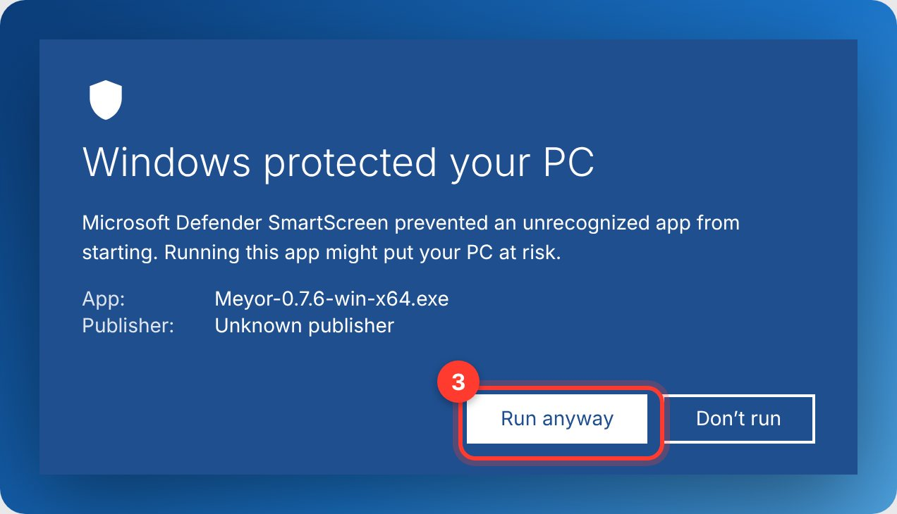
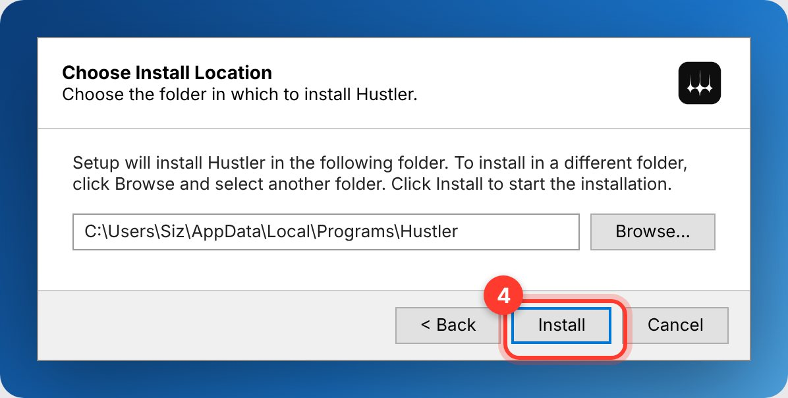
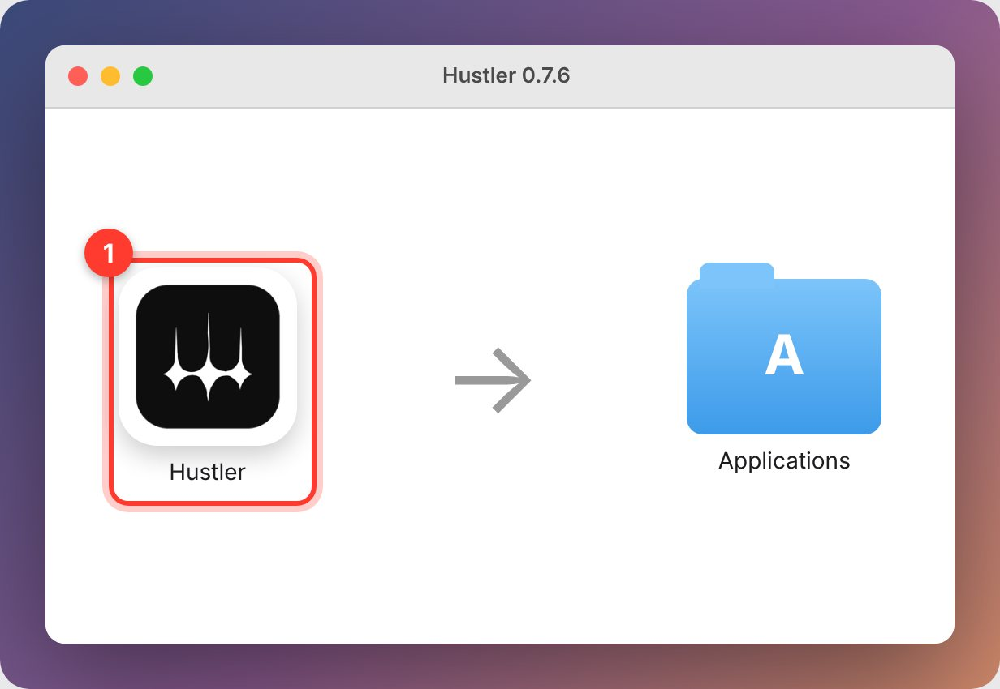
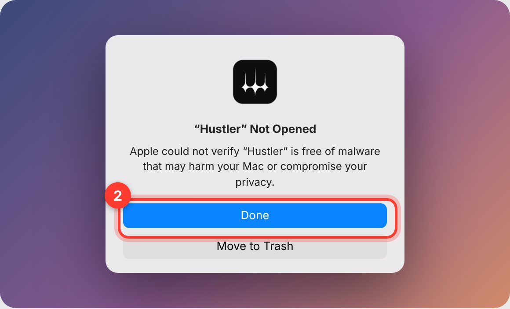
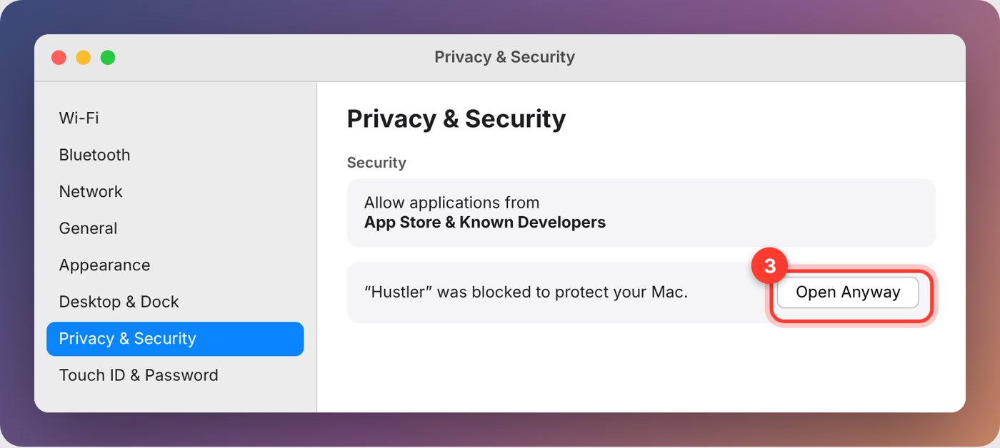
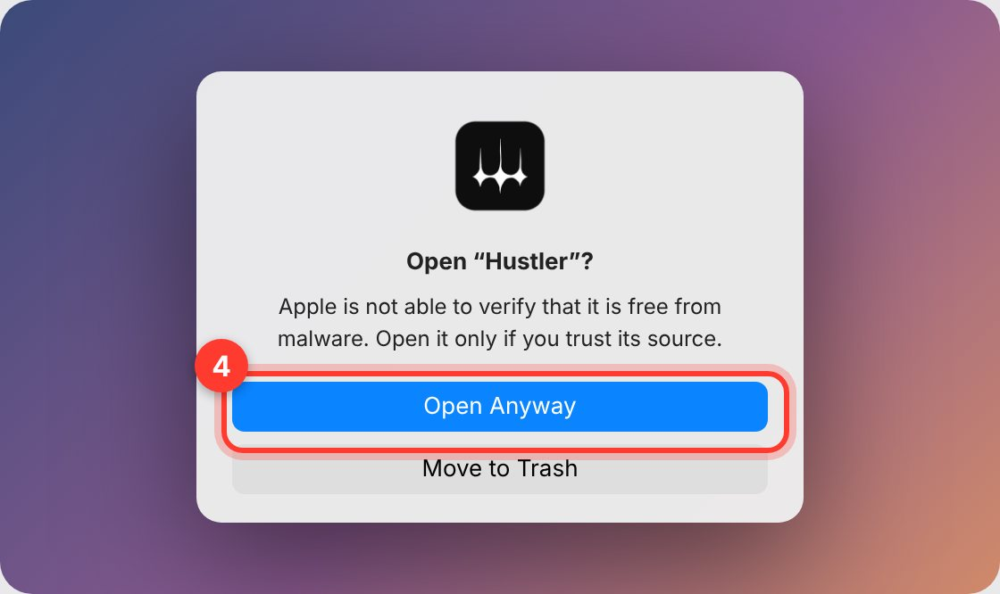
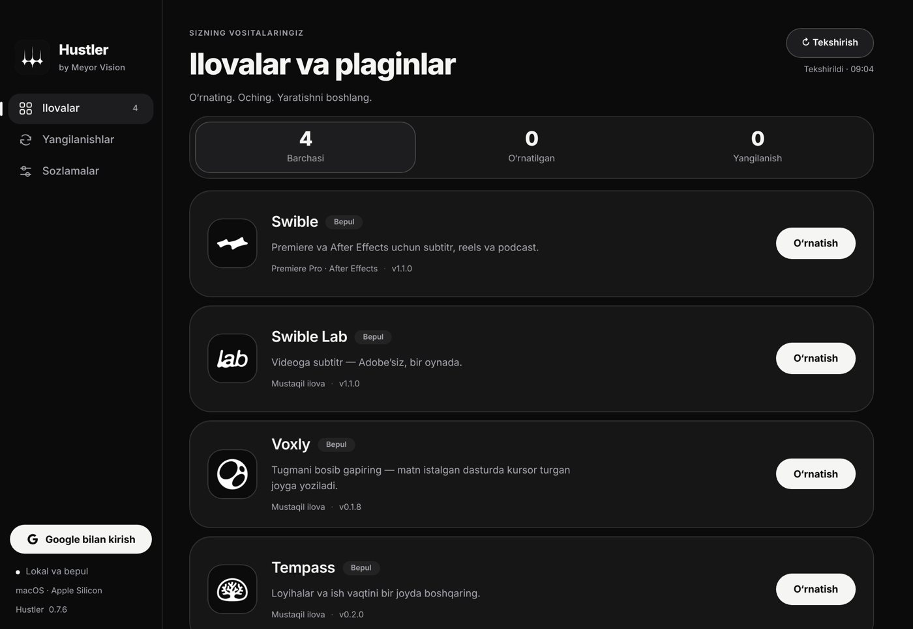

# Hustler — yuklab olish va yangilanishlar

**Hustler by Meyor Vision** — video montajchilar uchun bepul ilovalar: **Swible** (Premiere Pro / After Effects plagini), **Swible Lab**, **Voxly** va **Tempass**.

- Sayt: https://azizbek-dsgn.github.io/Meyor-Releases/
- Yuklab olish: [saytdan](https://azizbek-dsgn.github.io/Meyor-Releases/#download) — macOS (Apple Silicon, Intel) va Windows x64
- Qo‘llanma: [O‘rnatish (rasmlar bilan)](https://azizbek-dsgn.github.io/Meyor-Releases/install.html)

## O‘rnatish

Hustler bepul va hali Apple / Microsoft’ning pullik “tasdiqlangan dasturchi” sertifikatisiz chiqadi, shuning uchun birinchi ochishda tizim ogohlantiradi. Bir marta ruxsat bersangiz bo‘ldi — keyin Hustler o‘zini o‘zi yangilaydi.

### Windows

1. Saytdagi **Windows** tugmasini bosing va yuklangan `Meyor-…-win-x64.exe` ni oching.

   Edge “isn't commonly downloaded” desa: faylning **⋯** menyusi → **Keep** → **Show more** → **Keep anyway**.

    
2. “Windows protected your PC” chiqsa — **More info** ni bosing.

   
3. **Run anyway** ni bosing.

   
4. **Install** ni bosing (administrator paroli kerak emas). Hustler o‘zi ochiladi.

   

### macOS

Apple menyusi → **About This Mac**: “Apple M…” bo‘lsa **Apple Silicon**, “Intel” bo‘lsa **Intel** versiyasini yuklang.

1. DMG’ni oching va **Hustler**’ni **Applications** papkasiga torting.

   
2. Hustler’ni oching. “Apple could not verify…” chiqsa — **Done** ni bosing.

   
3. **System Settings → Privacy & Security** → pastda “Hustler was blocked…” yonidagi **Open Anyway**.

   
4. Yana **Open Anyway** va Mac parolingiz (yoki Touch ID).

   

macOS 13–14’da: Hustler’ni **Control + bosish** → **Open** → **Open**. Yoki Terminal’da:

```bash
xattr -dr com.apple.quarantine /Applications/Hustler.app && open /Applications/Hustler.app
```

### Birinchi ishga tushirish

**Ilovalar** bo‘limida kerakli ilova yonidagi **O‘rnatish** ni bosing. AI uchun: **Sozlamalar → AI yordamchi** (Claude Code, Codex yoki Google Antigravity).



## Bu repo nima

Bu repo faqat **tayyor dasturlarni tarqatadi**: kompilyatsiya qilingan installerlar, himoyalangan paketlar va Hustler o‘qiydigan yangilanish katalogi (`catalog.json`).

**Bu ochiq manbali loyiha emas.** Ilovalarning manba kodi yopiq repolarda saqlanadi. Yig‘ish uchun kod faqat shifrlangan holda (`build-inputs/*.enc`) keladi, kalit esa faqat GitHub Secrets’da. Relizlardagi paketlar mashina kodiga kompilyatsiya qilingan va chalkashtirilgan (obfuscated).

GitHub har bir relizga avtomatik “Source code (zip / tar.gz)” arxivini qo‘shadi. Unda faqat shu tarqatish reposi (katalog, yig‘ish skriptlari, shifrlangan fayllar) bor — ilovalarning kodi emas.

## Huquqlar

© 2026 Meyor Vision. Barcha huquqlar himoyalangan. Bepul tarqatish ochiq manba litsenziyasini bermaydi: dasturlarni nusxalash, qayta sotish yoki teskari muhandislik qilish mumkin emas. Uchinchi tomon komponentlari o‘z litsenziyalariga ega.

[Maxfiylik siyosati](https://azizbek-dsgn.github.io/Meyor-Releases/privacy.html) · [Foydalanish shartlari](https://azizbek-dsgn.github.io/Meyor-Releases/terms.html)

---

**English.** This repository only distributes compiled Hustler apps and the update catalog. It is **not open source**: product source code is private, build inputs are encrypted, and GitHub’s automatic “Source code” archives contain only this distribution repository. © 2026 Meyor Vision, all rights reserved.
